# پروتکل نیروست - دیاگرام‌های معماری

> توضیح: عنوان‌ها و متن توضیحی این سند به فارسی ترجمه شده‌اند. کدهای دیاگرام Mermaid (شناسه‌های گره، برچسب‌ها، sequenceDiagram و classDiagram) به‌عمد به انگلیسی نگه داشته شده‌اند تا نحو (syntax) دیاگرام‌ها و رندر صحیح آن‌ها در GitHub/VS Code/Mermaid Live Editor حفظ شود.

## فهرست مطالب
۱. [نمای کلی سطح‌بالای سیستم](#1-high-level-system-overview)
۲. [معماری اجزای سطح‌میانی](#2-mid-level-component-architecture)
۳. [دیاگرام‌های جریان سطح‌پایین](#3-low-level-flow-diagrams)
۴. [ردیابی داده (Data Lineage)](#4-data-lineage)
۵. [ساختار قرارداد](#5-contract-structure)
۶. [دیاگرام‌های توالی (Sequence)](#6-sequence-diagrams)

---

## ۱. نمای کلی سطح‌بالای سیستم

### ۱.۱ معماری کامل پروتکل

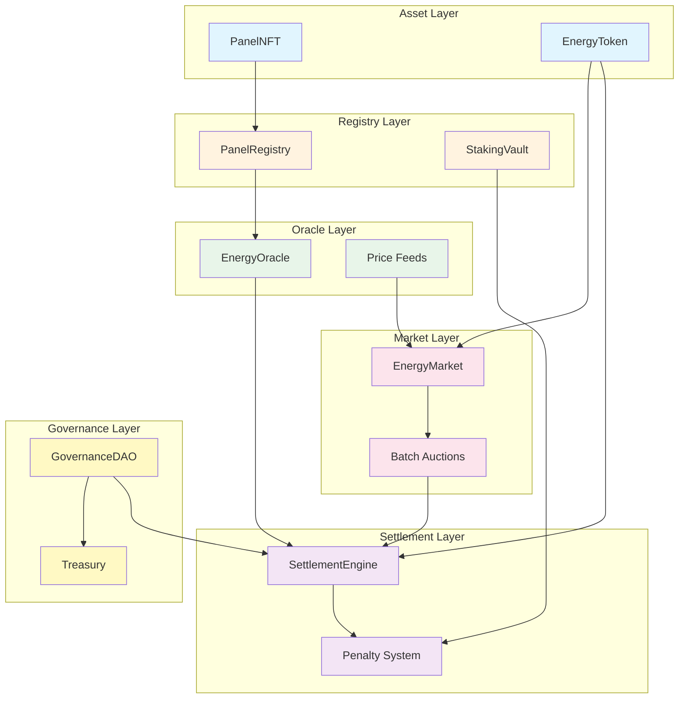

### ۱.۲ نقشهٔ ساده‌شدهٔ پروتکل

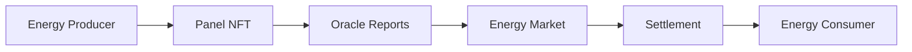

---

## ۲. معماری اجزای سطح‌میانی

### ۲.۱ سلسله‌مراتب قراردادهای هوشمند

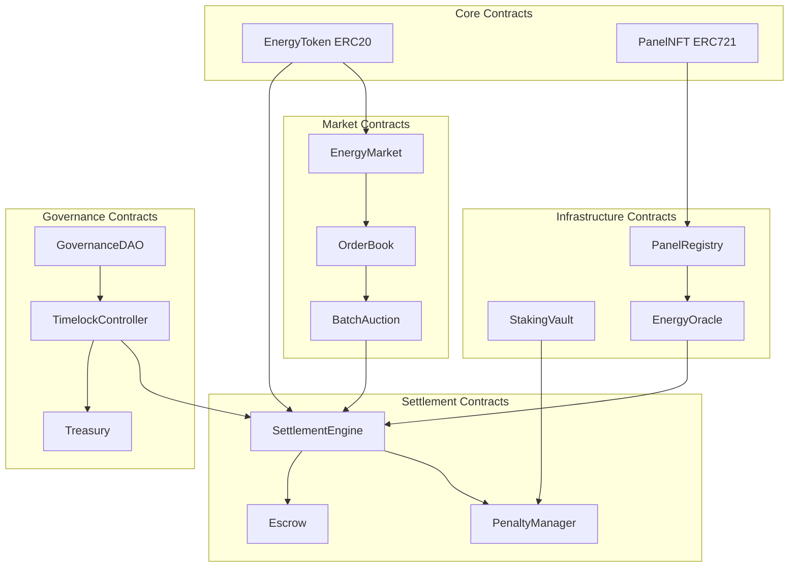

### ۲.۲ سیستم بازهٔ زمانی

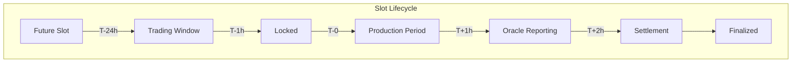

### ۲.۳ سازوکار حراج دسته‌ای

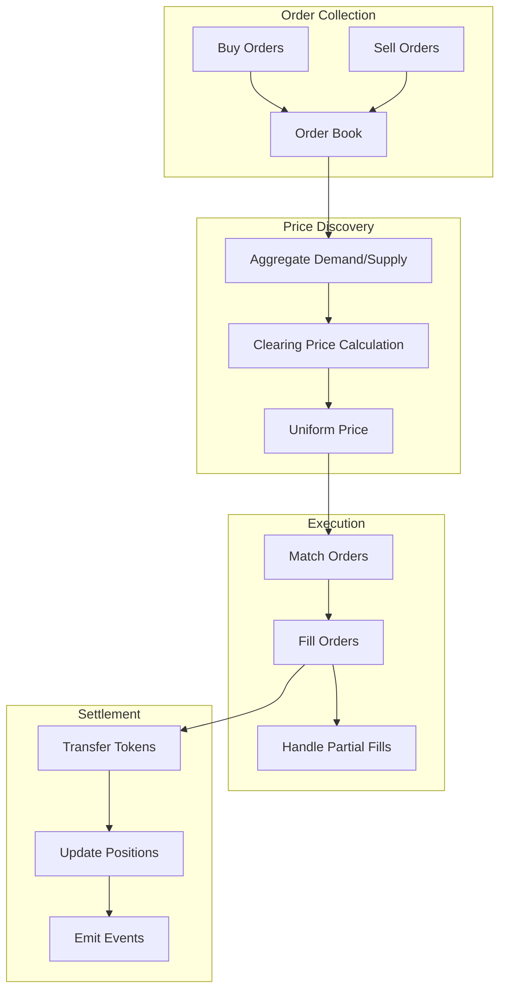

---

## ۳. دیاگرام‌های جریان سطح‌پایین

### ۳.۱ جریان ثبت پنل

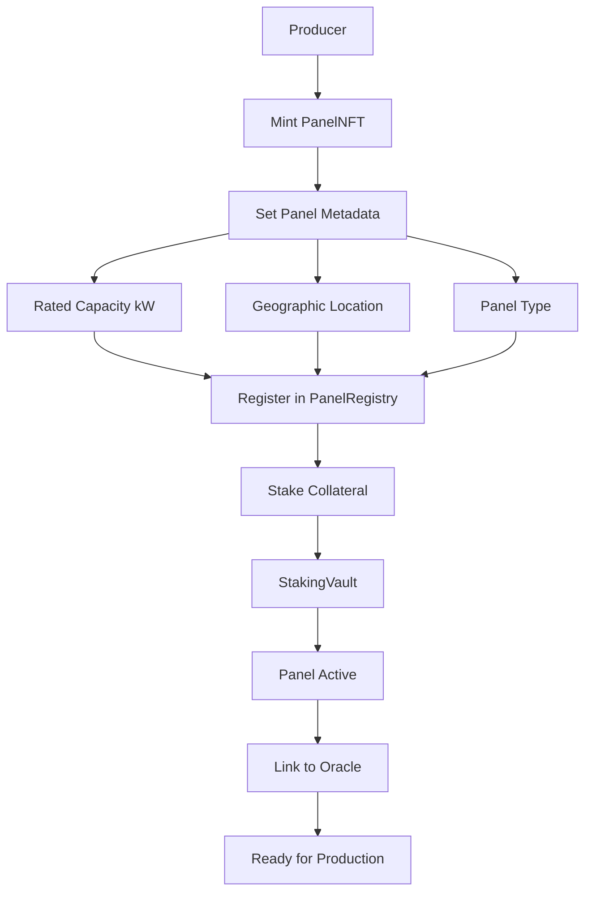

### ۳.۲ جریان تسویهٔ انرژی

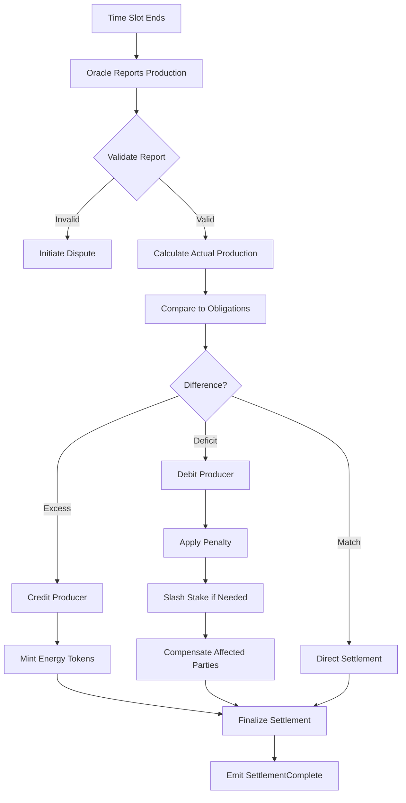

### ۳.۳ جریان پیشنهاد حاکمیت

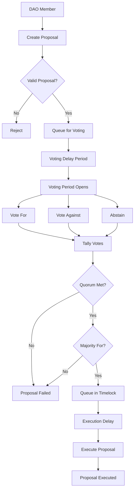

---

## ۴. ردیابی داده (Data Lineage)

### ۴.۱ ردیابی دادهٔ تولید انرژی

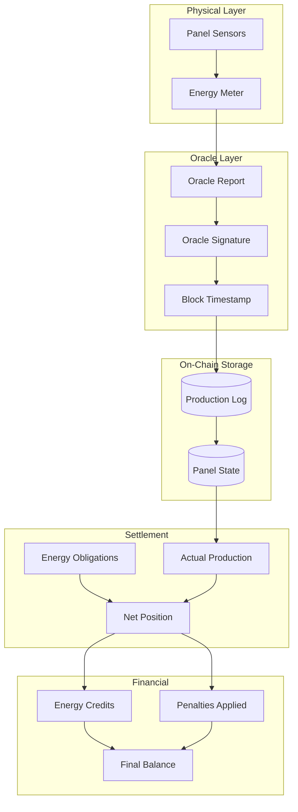

### ۴.۲ ردیابی جریان توکن

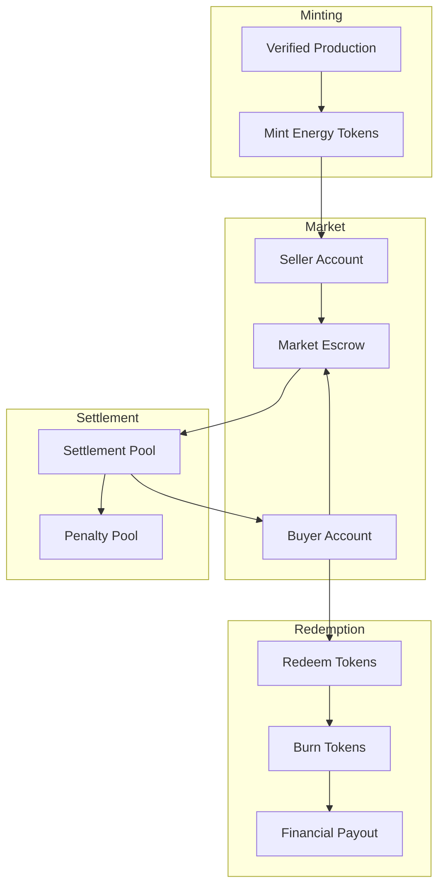

---

## ۵. ساختار قرارداد

### ۵.۱ وراثت قراردادهای هسته

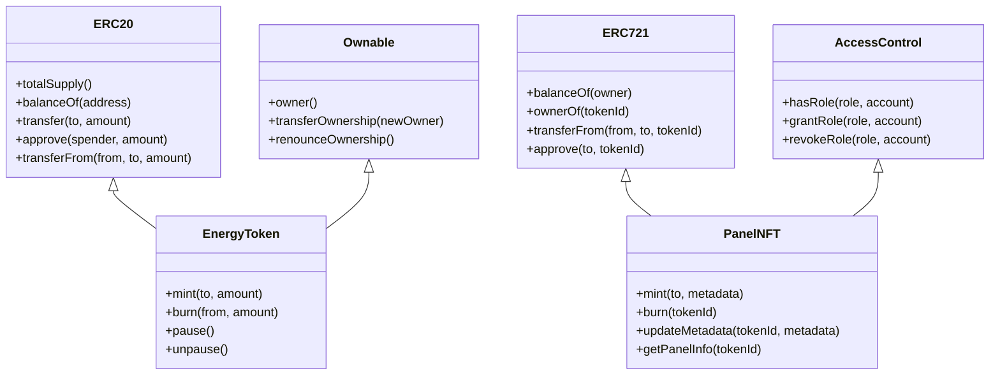

### ۵.۲ ساختار قرارداد تسویه

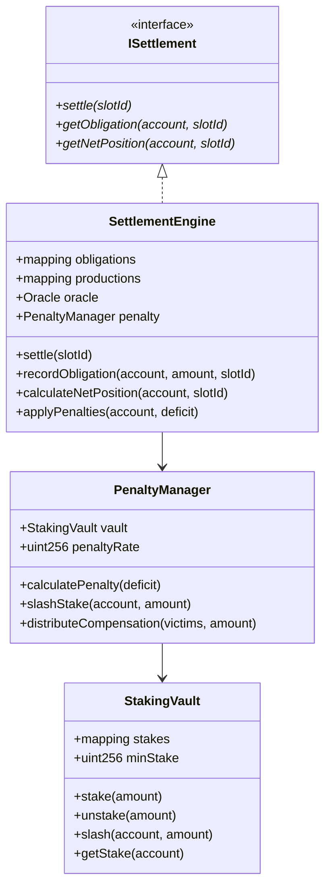

### ۵.۳ ساختار قرارداد بازار

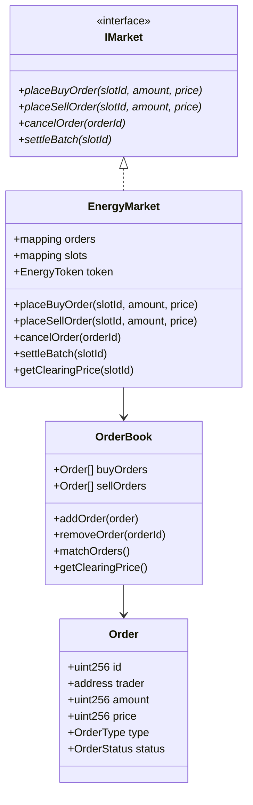

---

## ۶. دیاگرام‌های توالی (Sequence)

### ۶.۱ توالی ثبت پنل

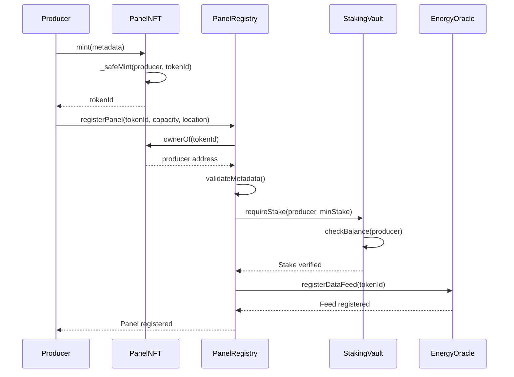

### ۶.۲ توالی معاملهٔ انرژی

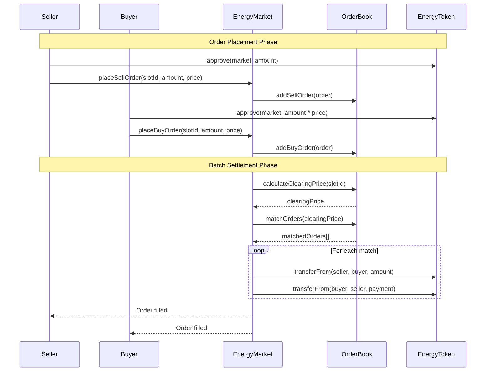

### ۶.۳ توالی تسویه

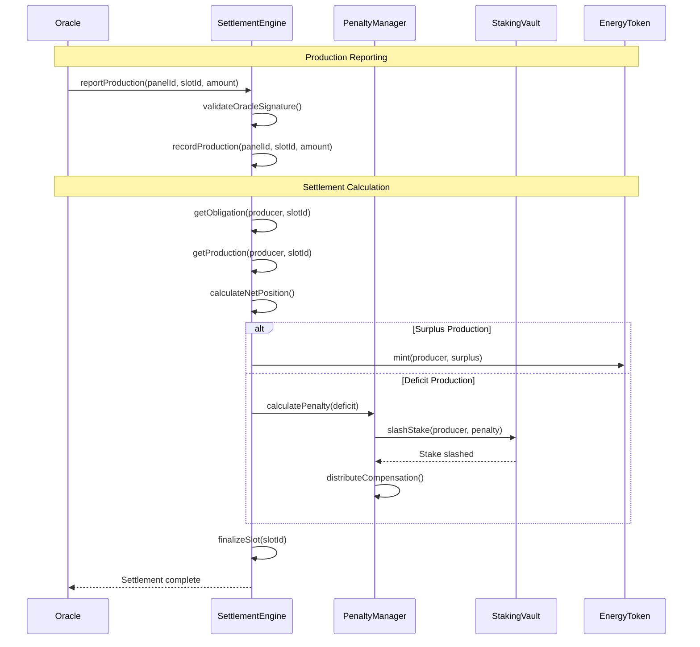

### ۶.۴ توالی حاکمیت

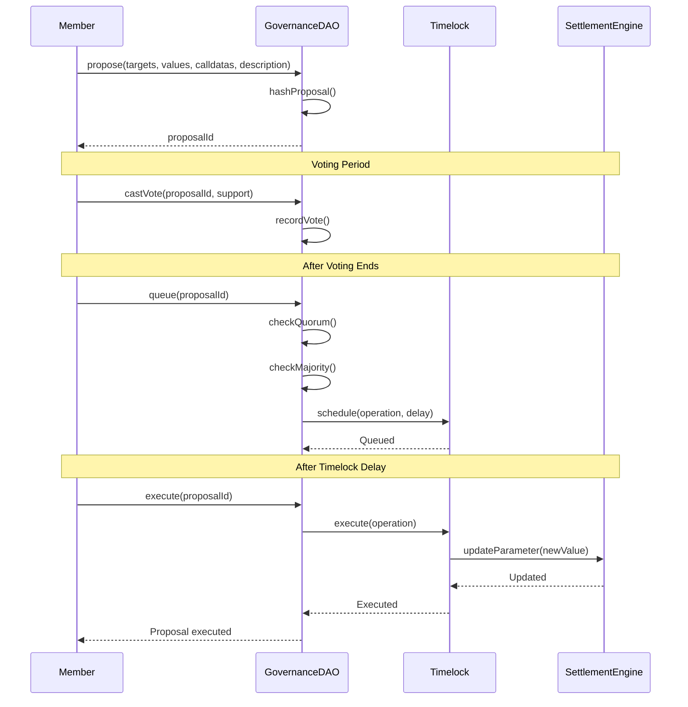

---

## ۷. نقشهٔ یکپارچهٔ سیستم

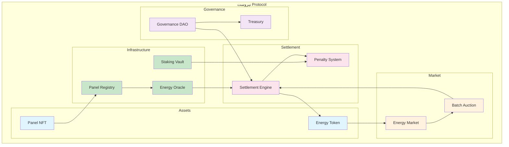

---

## استفاده

این دیاگرام‌ها را در موارد زیر مشاهده کنید:
- پیش‌نمایش مارک‌داون GitHub/GitLab
- VS Code همراه با افزونهٔ Mermaid
- [Mermaid Live Editor](https://mermaid.live/)
